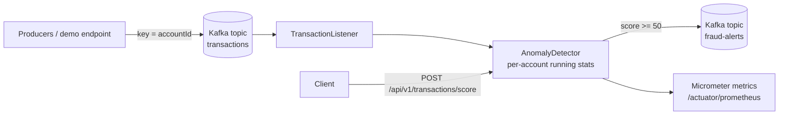

# txn-anomaly-stream

A Spring Boot 3 / Java 21 service that reads card transactions from Apache Kafka, scores each one against the account's own history and publishes explainable fraud alerts to another topic.

> **Representative portfolio project.** I wrote it independently using **synthetic data only**. It is not code from, or a copy of, any bank's or client's system. It shows the kind of work I do: event-driven Spring Boot services, Kafka and explainable risk scoring.

## Business problem

Fraud analysts need suspicious transactions surfaced in seconds, with a clear reason attached. A score with no explanation gets ignored, and too many false alarms bury the real ones. This service scores every transaction as it streams in. Each alert carries plain-English reasons an analyst or auditor can check.

## Architecture



Messages are keyed by account ID, so each account's transactions stay in order within a partition and its running statistics update in sequence.

### Scoring signals

| Signal | Rule | Points |
| --- | --- | --- |
| Amount spike | z-score ≥ 3 against the account's running mean (Welford's algorithm, O(1) per event); needs 5+ prior transactions | 45 |
| New country | Country not seen before on this account (after 5+ transactions) | 25 |
| Velocity | More than 5 transactions in 10 minutes | 30 |
| Merchant risk | Category in `crypto`, `gift_cards`, `wire_transfer` | 15 |

A score of 50 or more is flagged. Every rule adds a human-readable reason, and an `Explainer` turns the reasons into an analyst summary. The default explainer is a template. An LLM-backed explainer can implement the same interface and receives only the structured reasons, never raw card data.

## Tech stack

Java 21 · Spring Boot 3.3 · Spring Kafka · Apache Kafka (KRaft) · Micrometer / Prometheus · JUnit 5 · AssertJ · Embedded Kafka · Docker Compose · GitHub Actions

## Run it

```bash
docker compose up --build          # Kafka + the service on :8081
curl -X POST "localhost:8081/api/v1/demo/publish?accounts=20&perAccount=30"
docker compose exec kafka /opt/kafka/bin/kafka-console-consumer.sh \
  --bootstrap-server localhost:9092 --topic fraud-alerts --from-beginning
```

Without Kafka, score a single transaction:

```bash
curl -s localhost:8081/api/v1/transactions/score -H 'Content-Type: application/json' -d '{
  "id":"TX-1","accountId":"ACC-1","amount":42.10,"currency":"USD",
  "merchantCategory":"grocery","country":"US","timestamp":"2026-01-05T10:00:00Z"}'
```

Sample alert (from the synthetic data set):

```json
{
  "transactionId": "TX-30", "accountId": "ACC-1000", "score": 85, "flagged": true,
  "reasons": [
    "Amount 360.00 is 37.6 standard deviations above this account's average of 30.11",
    "First transaction from country RO",
    "High-risk merchant category: crypto"
  ],
  "explanation": "Review transaction TX-30 on account ACC-1000 (360.00 USD, crypto): ..."
}
```

## Tests

```bash
mvn verify
```

- `AnomalyDetectorTest`: on 1,550 synthetic transactions (50 accounts, 50 injected anomalies) it flags all 50 with at most 1% false positives. Also covers reasons, velocity, cold start and validation.
- `KafkaFlowTest`: end to end through an embedded Kafka broker. 11 transactions in plus one malformed message produce exactly one alert out.

The synthetic anomalies are deliberately obvious. Real fraud detection needs labelled data, tuning against precision and recall targets, and analyst feedback loops.

## Security and reliability notes

- Malformed messages are counted (`anomaly.transactions.rejected`) and skipped so one bad record can't block a partition. A dead-letter topic is the next step.
- Producer uses `acks=all`. No card numbers are processed: the synthetic schema uses account references only.
- The container runs as a non-root user. Stack traces are never returned to clients.

## Limitations and next steps

- Account profiles live in memory, so they reset on restart and are not shared across instances. Next: Kafka Streams state stores or Redis.
- Add a dead-letter topic, schema registry (Avro) and Testcontainers-based tests.
- Add an LLM `Explainer` (OpenAI or AWS Bedrock) with prompt and response logging for audit.

## License

MIT
